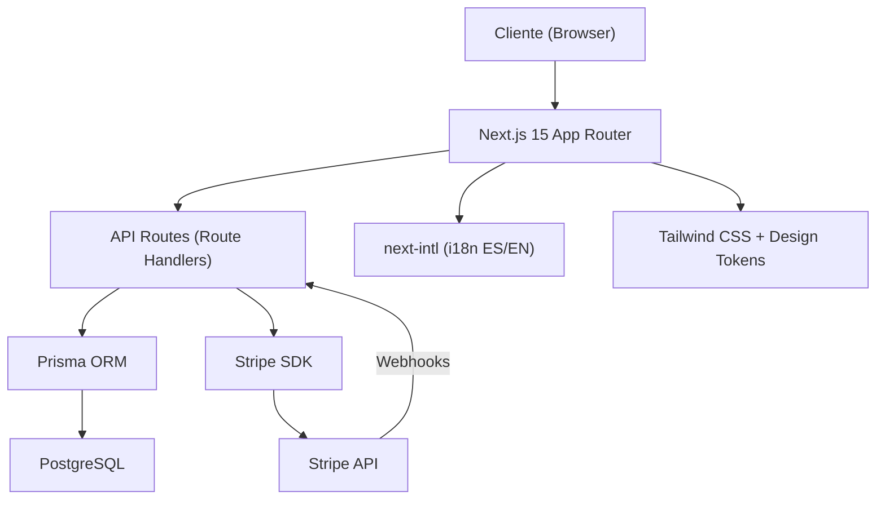

# 🏗️ PLAN MAESTRO DE INGENIERÍA — LUMO HQ

> **"Negocios Locales, Visibles"**  
> Plataforma completa de ventas, demos, pagos, CRM y operaciones para negocios latinos en Midland-Odessa, Texas.

> [!IMPORTANT]
> Este documento es la **fuente de verdad técnica** del proyecto. Toda decisión de arquitectura, diseño y seguridad se traza a los 4 documentos de gobernanza en `docs/`.

---

## 1. RESUMEN EJECUTIVO

| Dato | Valor |
|---|---|
| **Titular Legal** | Luis Barbera (DBA "Lumo HQ", Midland, TX) — Sin LLC |
| **Técnico** | Carlos Gómez (colaborador remoto, 50% ganancia) |
| **Ventas** | Bárbara (remota, tope $500 en 3 meses) |
| **Horizonte** | 90 días → 30 clientes → $3,000/mes MRR |
| **Stack** | Next.js 15 + TypeScript + Tailwind CSS + Prisma + PostgreSQL + Stripe |
| **Estándares** | OWASP ASVS L2, ISO 27001, PCI-DSS, WCAG 2.1 AA, Mobile-First |

---

## 2. IDENTIDAD VISUAL (Extraída de `docs/LumoHQ_Identidad_Organizada`)

### 2.1 Paleta de Colores (de `colores.txt`)

| Token Tailwind | Nombre | HEX | RGB | Uso |
|---|---|---|---|---|
| `noche` | Noche | `#1B2130` | 27, 33, 48 | Textos, fondos oscuros |
| `ambar` | Ámbar Lumo | `#F2A33A` | 242, 163, 58 | Punto de marca, botones, acentos |
| `brillo` | Brillo | `#FFD27A` | 255, 210, 122 | Destellos sobre fondo oscuro |
| `arena` | Arena | `#FFF7EC` | 255, 247, 236 | Fondos claros |
| `pizarra` | Pizarra | `#5B6375` | 91, 99, 117 | Texto secundario |
| `niebla` | Niebla | `#E6E8EE` | 230, 232, 238 | Líneas y bordes |

### 2.2 Tipografía (Fuentes WOFF2 locales)

| Fuente | Pesos | Uso |
|---|---|---|
| **Bricolage Grotesque** | Bold 700, ExtraBold 800 | Títulos y headings |
| **Figtree** | Regular 400, SemiBold 600, Bold 700 | Cuerpo, botones, tablas, UI |

### 2.3 Assets Web Requeridos

```
public/
├── fonts/
│   ├── bricolage-grotesque-latin-700-normal.woff2
│   ├── bricolage-grotesque-latin-800-normal.woff2
│   ├── figtree-latin-400-normal.woff2
│   ├── figtree-latin-600-normal.woff2
│   └── figtree-latin-700-normal.woff2
├── images/
│   ├── logos/            # SVG + PNG de 01_Logo_Maestro
│   ├── og-image.png      # imagen-para-compartir_1200x630.png
│   ├── email-signatures/ # firmas de correo
│   ├── print/            # sticker, tarjetas, catálogo
│   └── demos/            # assets para demos barbería/taquería
├── favicon.ico
├── favicon-16x16.png
├── favicon-32x32.png
├── favicon-48x48.png
├── apple-touch-icon.png  # 180px
├── icon-192.png          # Android
├── icon-512.png          # PWA
└── site.webmanifest
```

---

## 3. ARQUITECTURA TÉCNICA

### 3.1 Stack Tecnológico



| Capa | Tecnología | Justificación |
|---|---|---|
| **Framework** | Next.js 15 (App Router) | SSR/SSG, API routes, middleware, i18n nativo |
| **Lenguaje** | TypeScript strict | Type safety en toda la cadena |
| **Estilos** | Tailwind CSS 4 | Utility-first, design tokens, responsive |
| **ORM** | Prisma | Type-safe queries, migrations, parametrización anti-SQLi |
| **DB** | PostgreSQL | ACID, JSON support, escalable |
| **Auth** | NextAuth.js v5 + Argon2id | JWT en cookies HttpOnly, RBAC |
| **Pagos** | Stripe SDK | Checkout, Subscriptions, Webhooks |
| **i18n** | next-intl | Conmutador ES/EN instantáneo |
| **Validación** | Zod | Esquemas compartidos client/server |
| **Testing** | Vitest + Playwright | Unit, integration, E2E + visual |
| **Seguridad** | Helmet, CSP, CSRF tokens | Hardening de cabeceras |

### 3.2 Arquitectura de Carpetas

```
LumoHQ/
├── docs/                          # 🔒 SOLO LECTURA - Documentación fuente
├── public/                        # Assets estáticos (fonts, images, favicons)
├── prisma/
│   ├── schema.prisma              # Modelo de datos
│   ├── seed.ts                    # Datos iniciales
│   └── migrations/                # Migraciones versionadas
├── src/
│   ├── app/
│   │   ├── [locale]/              # Rutas internacionalizadas (es/en)
│   │   │   ├── layout.tsx         # Layout raíz con fonts y meta
│   │   │   ├── page.tsx           # Landing Page
│   │   │   ├── demo/
│   │   │   │   ├── barberia/      # Demo barbería
│   │   │   │   └── taqueria/      # Demo taquería
│   │   │   ├── checkout/          # Flujo de compra
│   │   │   ├── propuesta/[id]/    # Propuesta personalizada
│   │   │   └── portal/            # Portal del cliente
│   │   ├── admin/                 # Panel CRM/ERP (protegido por RBAC)
│   │   │   ├── crm/               # Gestión de prospectos y lotes
│   │   │   ├── produccion/        # Línea de 5 días
│   │   │   ├── finanzas/          # Motor financiero y reportes
│   │   │   ├── clientes/          # Expedientes de clientes
│   │   │   └── configuracion/     # Settings del sistema
│   │   └── api/
│   │       ├── auth/              # NextAuth endpoints
│   │       ├── webhooks/
│   │       │   └── stripe/        # Webhook handler con firma
│   │       ├── prospects/         # CRUD prospectos
│   │       ├── clients/           # CRUD clientes
│   │       ├── contracts/         # Firma digital + hash SHA-256
│   │       ├── payments/          # Lógica Stripe
│   │       ├── reports/           # Generador de reportes
│   │       ├── reviews/           # Kit QR de reseñas
│   │       ├── diagnosis/         # Diagnóstico en 24h
│   │       └── uploads/           # Subida de fotos con Magic Bytes
│   ├── components/
│   │   ├── ui/                    # Componentes base (Button, Input, Card...)
│   │   ├── layout/                # Navbar, Footer, Sidebar, MobileNav
│   │   ├── landing/               # Hero, Packages, FAQ, DiagnosisForm
│   │   ├── demos/                 # Componentes de demos
│   │   ├── checkout/              # Contract, Payment steps
│   │   ├── portal/                # Client portal components
│   │   ├── admin/                 # CRM, Kanban, Finance components
│   │   └── shared/                # LanguageSwitcher, SEO, Analytics
│   ├── lib/
│   │   ├── auth.ts                # NextAuth config + RBAC
│   │   ├── db.ts                  # Prisma client singleton
│   │   ├── stripe.ts              # Stripe client + helpers
│   │   ├── finance.ts             # Motor de cascada financiera
│   │   ├── contracts.ts           # Firma digital + SHA-256
│   │   ├── uploads.ts             # Validación Magic Bytes + EXIF strip
│   │   ├── rate-limit.ts          # Rate limiting por IP/usuario
│   │   ├── csrf.ts                # Token anti-CSRF
│   │   ├── schemas.ts             # Esquemas Zod compartidos
│   │   └── i18n.ts                # Configuración next-intl
│   ├── messages/
│   │   ├── es.json                # Traducciones español
│   │   └── en.json                # Traducciones inglés
│   ├── middleware.ts              # Auth, i18n, security headers, rate limit
│   └── types/
│       ├── auth.ts                # Roles y permisos
│       ├── client.ts              # Tipos de cliente
│       ├── finance.ts             # Tipos financieros
│       └── prospect.ts            # Tipos de prospección
├── tests/
│   ├── unit/                      # Vitest unit tests
│   ├── integration/               # API integration tests
│   └── e2e/                       # Playwright E2E tests
├── scripts/
│   ├── security-audit.ts          # SAST scanner
│   └── copy-assets.ts             # Copia assets de docs/ a public/
├── .env.example                   # Variables de entorno
├── next.config.ts                 # Config Next.js con CSP
├── tailwind.config.ts             # Tokens de diseño Lumo HQ
├── tsconfig.json
├── package.json
└── PLAN_MAESTRO_INGENIERIA.md     # Este archivo
```

---

## 4. ESQUEMA DE BASE DE DATOS

```mermaid
erDiagram
    User ||--o{ Session : has
    User ||--o{ Prospect : manages
    User ||--o{ AuditLog : generates
    Client ||--|| User : "has account"
    Client ||--o{ Contract : signs
    Client ||--o{ Payment : makes
    Client ||--o{ ClientFile : uploads
    Client ||--o{ MonthlyReport : receives
    Client ||--o{ ChangeTicket : requests
    Client ||--o{ DeliveryChecklist : tracks
    Prospect ||--o| Client : converts
    Prospect }o--|| Batch : "belongs to"
    Contract ||--o{ Payment : authorizes
    Payment }o--|| FinancialWaterfall : distributes
    FinancialWaterfall ||--o{ Commission : pays
    Expense ||--o{ ExpenseApproval : requires

    User {
        uuid id PK
        string email UK
        string password_hash
        enum role "ADMIN_LUIS | ADMIN_CARLOS | SALES_BARBARA | CLIENT"
        string full_name
        boolean is_active
        int failed_login_attempts
        datetime locked_until
        datetime created_at
        datetime updated_at
    }

    Prospect {
        uuid id PK
        uuid batch_id FK
        uuid created_by FK
        string business_name
        string owner_name
        string phone
        string google_maps_url
        string instagram
        string facebook
        string whatsapp
        enum stage "LISTED | CONTACTED | DIAGNOSED | MET | CLOSED | FOLLOW_UP"
        int score_reviews
        int score_website
        int score_photos
        int score_hours
        int score_description
        int score_review_response
        int score_booking
        int score_spanish
        int total_score
        enum priority "P1 | P2 | DISCARD"
        enum source "BARBARA | LUIS | REFERRAL"
        int follow_up_count
        jsonb contact_notes
        datetime last_contacted_at
        datetime created_at
    }

    Batch {
        uuid id PK
        int batch_number "1-5"
        int target_size "30"
        datetime created_at
    }

    Client {
        uuid id PK
        uuid user_id FK UK
        uuid prospect_id FK
        uuid converted_by FK
        string business_name
        string owner_name
        string address
        string phone
        string whatsapp
        string email
        jsonb hours "per day + holidays"
        jsonb services "name, price, description"
        string service_area
        string description_es
        string description_en
        enum language "EN | ES | BOTH"
        enum extra_channel "BOOKING | IG_FB | WHATSAPP"
        enum package_type "FOUNDER | BASE | PREMIUM"
        decimal setup_price
        decimal monthly_price
        string domain
        string google_profile_url
        string review_short_link
        string review_qr_url
        enum status "ONBOARDING | DAY1_PENDING | IN_PRODUCTION | REVIEW | ACTIVE | CANCELLED"
        boolean day1_checklist_complete
        boolean delivery_approved
        datetime clock_started_at
        datetime delivered_at
        datetime subscription_started_at
        datetime cancelled_at
        datetime created_at
    }

    Contract {
        uuid id PK
        uuid client_id FK
        enum contract_type "FOUNDER | BASE | PREMIUM"
        text contract_html
        text contract_text
        string signer_name
        string signer_ip
        datetime signed_at_utc
        string document_hash_sha256
        boolean includes_portfolio_permission
        boolean includes_testimonial_permission
        bytea signed_pdf
        datetime created_at
    }

    Payment {
        uuid id PK
        uuid client_id FK
        uuid contract_id FK
        string stripe_payment_intent_id UK
        string stripe_checkout_session_id
        string stripe_subscription_id
        enum payment_type "DEPOSIT_50 | FINAL_50 | SUBSCRIPTION | EXTRA_CHANGE | MAJOR_WORK"
        decimal amount
        decimal stripe_fee
        decimal texas_sales_tax
        enum status "PENDING | COMPLETED | FAILED | REFUNDED"
        string idempotency_key UK
        datetime paid_at
        datetime created_at
    }

    FinancialWaterfall {
        uuid id PK
        uuid payment_id FK
        decimal gross_amount
        decimal stripe_fee
        decimal barbara_commission
        decimal tools_and_domain
        decimal business_fund_8pct
        decimal carlos_share
        decimal luis_share
        decimal luis_tax_reserve
        decimal texas_sales_tax_collected
        datetime calculated_at
    }

    Commission {
        uuid id PK
        uuid payment_id FK
        uuid recipient_id FK
        decimal amount
        string description
        boolean is_paid
        datetime paid_at
    }

    ClientFile {
        uuid id PK
        uuid client_id FK
        string filename
        string storage_path
        string mime_type
        int file_size
        string magic_bytes_verified
        boolean rights_confirmed
        datetime uploaded_at
    }

    DeliveryChecklist {
        uuid id PK
        uuid client_id FK
        int day_number "0-5"
        string task_description
        boolean completed
        uuid completed_by FK
        datetime completed_at
    }

    MonthlyReport {
        uuid id PK
        uuid client_id FK
        int month_number
        int year
        int profile_views
        int profile_views_prev
        int google_calls
        int directions_clicks
        int website_visits
        int channel_messages
        int new_reviews
        decimal avg_rating
        text summary
        text recommendation
        datetime generated_at
    }

    ChangeTicket {
        uuid id PK
        uuid client_id FK
        string description
        enum ticket_type "SMALL_CHANGE | EXTRA_CHANGE | MAJOR_WORK"
        int estimated_minutes
        decimal charge_amount
        string stripe_payment_link
        enum status "REQUESTED | IN_PROGRESS | COMPLETED | BLOCKED"
        int month_change_count "max 2 free"
        datetime created_at
        datetime completed_at
    }

    Expense {
        uuid id PK
        string description
        decimal amount
        enum category "DBA | ESIM | DOMAIN | PRINTS | TOOLS | MILEAGE | OTHER"
        string receipt_path
        boolean requires_dual_approval
        datetime created_at
    }

    ExpenseApproval {
        uuid id PK
        uuid expense_id FK
        uuid approved_by FK
        boolean approved
        datetime decided_at
    }

    BarbaraCommissionTracker {
        uuid id PK
        int clients_1_to_5_count
        int clients_6_to_30_count
        decimal total_earned
        decimal cap "500.00"
        boolean cap_reached
        datetime updated_at
    }

    WeeklyHoursLog {
        uuid id PK
        uuid user_id FK
        int week_number
        int year
        decimal hours_logged
        int contacts_made
        datetime created_at
    }

    KPIDashboard {
        uuid id PK
        int day_checkpoint "14 | 30 | 60 | 90"
        int businesses_listed_target
        int businesses_listed_actual
        int businesses_contacted_target
        int businesses_contacted_actual
        int real_conversations_target
        int real_conversations_actual
        int diagnoses_sent_target
        int diagnoses_sent_actual
        int meetings_proposals_target
        int meetings_proposals_actual
        int clients_closed_target
        int clients_closed_actual
        decimal mrr_target
        decimal mrr_actual
        datetime snapshot_at
    }

    LegalVault {
        uuid id PK
        enum document_type "DBA | SALES_TAX_PERMIT | W8BEN_CARLOS | W8BEN_BARBARA | COLLABORATION_AGREEMENT"
        string file_path
        datetime valid_from
        datetime valid_until
        datetime uploaded_at
    }

    AuditLog {
        uuid id PK
        uuid user_id FK
        string action
        string resource_type
        uuid resource_id
        jsonb old_values
        jsonb new_values
        string ip_address
        string user_agent
        datetime created_at
    }
```

---

## 5. ROLES Y PERMISOS (RBAC)

| Recurso | ADMIN_LUIS | ADMIN_CARLOS | SALES_BARBARA | CLIENT |
|---|---|---|---|---|
| **Contratos** — crear, firmar | ✅ Crear | ❌ | ❌ | ✅ Firmar propio |
| **Pagos Stripe** — cobrar | ✅ | ❌ | ❌ | ✅ Pagar propio |
| **Prospectos (CRM)** | ✅ Ver todos | ✅ Ver todos | ✅ Sus lotes | ❌ |
| **Clientes** — expedientes | ✅ Todos | ✅ Todos | ✅ Solo datos de contacto | ✅ Solo su propio |
| **Línea Producción** | ✅ Revisar | ✅ Ejecutar | ❌ | ❌ |
| **Finanzas/Reparto** | ✅ Total | ✅ Total | ✅ Solo sus comisiones | ❌ |
| **Bóveda Legal** | ✅ Total | ✅ Ver | ❌ | ❌ |
| **Gastos >$100** | ✅ Aprobar | ✅ Aprobar | ❌ | ❌ |
| **Configuración** | ✅ | ✅ | ❌ | ❌ |
| **Subida de fotos** | ✅ | ✅ | ✅ Día 1 | ✅ Sus fotos |
| **Reportes mensuales** | ✅ Todos | ✅ Generar | ❌ | ✅ Su reporte |
| **Diagnósticos** | ✅ | ✅ | ✅ Generar | ❌ |
| **Dashboard KPI** | ✅ | ✅ | ✅ Solo vista | ❌ |

---

## 6. PLAN DE SPRINTS — TAREAS VERIFICABLES

### SPRINT 1: Infraestructura + Landing Page Bilingüe
**Duración:** ~2 semanas | **Agentes:** UI/UX + Backend + QA + SecOps

#### 1.1 Inicialización del Proyecto
- [ ] Crear proyecto Next.js 15 con TypeScript, Tailwind, ESLint, Prettier
- [ ] Configurar `tailwind.config.ts` con tokens de color Lumo HQ
- [ ] Configurar fuentes locales WOFF2 (Bricolage Grotesque + Figtree) con `@font-face`
- [ ] Copiar assets: favicons, logos SVG/PNG, OG image a `public/`
- [ ] Configurar `<head>` con todos los favicons, meta OG, `site.webmanifest`
- [ ] Configurar `next-intl` con mensajes `es.json` y `en.json`
- [ ] Implementar `LanguageSwitcher` component (toggle ES/EN instantáneo)
- [ ] Configurar middleware de i18n (detección de idioma, redirección)

#### 1.2 Seguridad Perimetral
- [ ] Configurar CSP estricto (sin `unsafe-eval`) en `next.config.ts`
- [ ] Configurar HSTS con preload
- [ ] Configurar X-Frame-Options: DENY
- [ ] Configurar X-Content-Type-Options: nosniff
- [ ] Configurar Referrer-Policy: strict-origin-when-cross-origin
- [ ] Configurar Permissions-Policy
- [ ] Implementar Rate Limiting global por IP (middleware)

#### 1.3 Landing Page de Alta Conversión (100% Responsive)
- [ ] **Hero Section** bilingüe: "Que te encuentren en Google y te puedan llamar, escribir o reservar en un clic, sin que se te escape ningún cliente"
- [ ] **Demostrador Interactivo de Contacto Fácil**: selector visual de canales (Llamar + Texto + 1 extra)
- [ ] **Sección de Paquetes y Precios**:
  - Fundadores banner con contador dinámico (2 cupos)
  - Paquete Base: $500 + $100/mes
  - Paquete Premium: $1,000-$1,500 + $150-$200/mes
- [ ] **Formulario de Diagnóstico Gratuito** con Zod validation:
  - Nombre del dueño, negocio en Google Maps, teléfono, canal preferido
  - 2 preguntas obligatorias ("¿Cómo te llegan clientes?" + "¿Cómo te contactan?")
  - Casilla TCPA consent obligatoria
  - Rate limiting anti-spam
  - Sanitización XSS
- [ ] **FAQ / Objeciones interactivas** (accordion responsive):
  - 7 objeciones del Doc 03 con respuestas exactas
- [ ] **Cumplimiento FTC**: cero promesas de "primer lugar", "duplicar clientes", "conseguir reseñas"
- [ ] **Sticky CTA Bar** en móvil (Llamar + WhatsApp al hacer scroll)
- [ ] **Footer** con datos legales, links, logos

#### 1.4 Responsive Verification
- [ ] Sin overflow-x en 320-375px (iPhone SE/Mini)
- [ ] Botones fijos (Sticky CTA) en 390-430px
- [ ] Grillas adaptativas 2 col en 768-1024px
- [ ] Layout amplio max-w-1280 centrado en 1280-1920px+
- [ ] Botones mínimo 48×48px
- [ ] Tipografía fluida con `clamp()`
- [ ] Alto contraste WCAG AA

#### 1.5 Gate de Pruebas Sprint 1
- [ ] QA: renderizado sin fallos en 375px, 768px, 1440px
- [ ] QA: carga correcta de fuentes WOFF2
- [ ] QA: traducción completa ES/EN en toda la landing
- [ ] SecOps: auditar cabeceras HTTP (score A+ en securityheaders.com)
- [ ] SecOps: test XSS en formulario de diagnóstico
- [ ] SecOps: verificar Rate Limiting bloquea fuerza bruta

---

### SPRINT 2: Plantilla Maestra + 2 Demos + QR Reviews
**Duración:** ~2 semanas | **Agentes:** UI/UX + Backend + QA + SecOps

#### 2.1 Motor de Plantilla Maestra Bilingüe
- [ ] Sistema parametrizable de configuración JSON/DB por cliente
- [ ] Toggle de botones: llamar, texto, reservar, whatsapp, ig_fb
- [ ] Colores, logo, horarios con feriados dinámicos
- [ ] Servicios/menú configurables
- [ ] Dirección NAP idéntica a Google
- [ ] HTTPS automático con certificado

#### 2.2 Demo Barbería (`/demo/barberia`)
- [ ] Página bilingüe marcada "EJEMPLO / DEMO"
- [ ] Catálogo de cortes y barba con precios
- [ ] Horarios con feriados
- [ ] Mapa de ubicación integrado
- [ ] Flujo de reserva (estilo Square Appointments)
- [ ] Código QR de reseñas en mostrador
- [ ] Optimizada para mostrar desde teléfono de Luis

#### 2.3 Demo Taquería (`/demo/taqueria`)
- [ ] Página bilingüe marcada "EJEMPLO / DEMO"
- [ ] Menú digital interactivo por categorías
- [ ] Fotos y precios por platillo
- [ ] Botones flotantes móvil: Llamar, SMS, WhatsApp
- [ ] Mensaje de bienvenida WhatsApp
- [ ] Mapa de ubicación
- [ ] Sistema de reseñas QR

#### 2.4 Generador de Kit de Reseñas (FTC compliant)
- [ ] Generador de enlace corto a Google Reviews
- [ ] Plantilla de mensaje para clientes reales (texto aprobado)
- [ ] Generador de Sticker QR imprimible (1200×1200) usando arte oficial
- [ ] **Sin**: solicitar, incentivar o fabricar reseñas

#### 2.5 Portafolio "Antes y Después"
- [ ] Comparador visual deslizante (slider táctil responsive)
- [ ] Soporte touch/drag para móvil
- [ ] Integrado en Landing Page

#### 2.6 Gate de Pruebas Sprint 2
- [ ] QA: demos en navegación táctil móvil (iOS/Android simulated)
- [ ] QA: enlaces `tel:`, `sms:`, WhatsApp responden inmediatamente
- [ ] QA: botones cumplen 48×48px mínimo
- [ ] SecOps: auditar contra SSTI en motor de plantillas
- [ ] SecOps: auditar contra Open Redirects en enlaces cortos
- [ ] SecOps: auditar contra manipulación de parámetros URL

---

### SPRINT 3: Checkout, Contratos Digitales y Stripe
**Duración:** ~2 semanas | **Agentes:** Backend (líder) + UI/UX + QA + SecOps

#### 3.1 Flujo de Checkout y Propuestas
- [ ] `/checkout` — selector de paquete con bloqueo automático de cupos fundadores
- [ ] `/propuesta/[id]` — propuesta personalizada enviada por Luis/Bárbara
- [ ] Selector de canal extra
- [ ] Resumen de precio con desglose transparente

#### 3.2 Motor de Firma de Contrato Digital
- [ ] Contrato auto-rellenado con datos del cliente
- [ ] Firma electrónica en pantalla (canvas táctil para móvil)
- [ ] Registro: nombre completo, dirección IP, fecha/hora UTC
- [ ] Hash SHA-256 inmutable del documento firmado
- [ ] Cláusulas del Doc 03 y 04:
  - Sin promesas de primer lugar / volumen de ventas
  - Prohibición de reseñas falsas
  - Confirmación derechos de uso de fotos/logos
  - Límite de responsabilidad financiera
  - Cancelación mensualidad con 30 días aviso
  - Cláusula fundador: permiso "antes y después" + testimonio

#### 3.3 Integración Stripe Completa
- [ ] **Pago 1 (Día 0)**: Anticipo 50% — $125 (Fundador) / $250 (Regular) via Stripe Checkout
- [ ] **Pago 2 (Día 5)**: 50% restante + activación suscripción
- [ ] Suscripción $100/mes + Texas Sales Tax (~$6.60) desde mes siguiente
- [ ] Stripe Products/Prices precargados
- [ ] **Webhooks** (`/api/webhooks/stripe`):
  - Verificación estricta `Stripe-Signature`
  - Idempotencia con `idempotency_key`
  - Actualización automática de estado en DB
  - Manejo de `checkout.session.completed`, `invoice.paid`, `customer.subscription.*`

#### 3.4 Gate de Pruebas Sprint 3
- [ ] QA: contrato legible y firmable con dedo en móvil
- [ ] QA: flujo Stripe funcional en móvil y desktop
- [ ] SecOps: imposible alterar precios desde browser (Parameter Tampering)
- [ ] SecOps: imposible saltar firma antes de pago
- [ ] SecOps: webhook rechaza sin firma Stripe válida
- [ ] SecOps: webhook resiste Replay Attacks

---

### SPRINT 4: CRM, Portal del Cliente y Línea de 5 Días
**Duración:** ~2 semanas | **Agentes:** Backend + UI/UX + QA + SecOps

#### 4.1 CRM de Prospección
- [ ] **Gestor de Lotes de 30** (Lotes 1-5): tablero Kanban + tabla responsive
- [ ] **Embudo de 6 etapas**: Lista → Contacto → Diagnóstico → Reunión → Cierre → Seguimiento
- [ ] **Calificador de 8 señales** (checkboxes, puntaje automático, clasificación P1/P2/Descartar)
- [ ] Registro de origen (Bárbara / Luis / Referido)
- [ ] **Generador de Diagnóstico 1 página** (1 clic)
- [ ] **Guiones oficiales** con copiado rápido y variables auto-rellenadas
- [ ] Bloqueo de >3 seguimientos y mensajes masivos (TCPA)

#### 4.2 Portal del Cliente (`/portal`)
- [ ] **Checklist de Recolección Día 1** (formulario responsive):
  - Nombre exacto, dirección, teléfono, WhatsApp
  - Horario por día + feriados
  - Servicios/menú con precios
  - Zona de servicio, frases descriptivas, idioma
  - Canal extra escogido, correo
  - Logo + 10-20 fotos con confirmación de derechos
- [ ] **Reloj de entrega**: NO arranca sin 50% + checklist 100%
- [ ] **Política "Cero Contraseñas"**: instrucciones interactivas para invitaciones
- [ ] Vista previa de su web en construcción
- [ ] Botón de aprobación final (Día 5)

#### 4.3 Línea de Producción 5 Días (Panel ADMIN_CARLOS)
- [ ] **Día 0** (Luis): Contrato ✓, 50% ✓, carpeta ✓
- [ ] **Día 1** (Bárbara): Checklist recolección ✓, invitación Google ✓
- [ ] **Día 2** (Carlos): Dominio, Google Profile completo, web bilingüe
- [ ] **Día 3** (Carlos): Botones + canal extra, enlace corto, QR reseñas
- [ ] **Día 4** (Luis): Revisión checklist técnico, capturas antes/después
- [ ] **Día 5** (Luis + Carlos): Correcciones, aprobación, cobro 50% + suscripción

#### 4.4 Gate de Pruebas Sprint 4
- [ ] QA: flujo completo Lote 1 → Día 5 funcional
- [ ] QA: Portal y Kanban en móvil/tablet perfecto
- [ ] SecOps: test IDOR — cliente no ve expedientes de otros
- [ ] SecOps: test RBAC — Bárbara no modifica finanzas
- [ ] SecOps: cargador fotos valida Magic Bytes, rechaza ejecutables/SVG con scripts
- [ ] SecOps: límite de peso de subida

---

### SPRINT 5: Motor Financiero, Reportes y Hardening Final
**Duración:** ~2 semanas | **Agentes:** Backend + UI/UX + QA + SecOps (auditoría final)

#### 5.1 Motor Financiero Automatizado
- [ ] **Cascada de reparto** por cada pago:
  - Fundador $250: −$8 Stripe, −$25 Bárbara, −$20 tools, −$16 fondo 8%, ≈$90 Carlos, ≈$90 Luis, Luis aparta $25 impuestos
  - Regular 3-5 $500: −$15 Stripe, −$25 Bárbara, −$20 tools, −$35 fondo 8%, ≈$202 Carlos, ≈$202 Luis, Luis aparta $60
  - Regular 6-30 $500: −$15 Stripe, −$15 Bárbara, −$20 tools, −$36 fondo 8%, ≈$207 Carlos, ≈$207 Luis, Luis aparta $60
  - Mensualidad $100: descuenta Stripe+hosting, 8% fondo, 50/50, Luis aparta $11
- [ ] **Tope de Bárbara**: contador automático, $500 cap, $0 si Referido o cap alcanzado
- [ ] **Bóveda legal**: DBA, permiso sales tax, contratos, W-8BEN

#### 5.2 Registro de Gastos y Millas
- [ ] Gastos con categorías (DBA $400 arranque, eSIM, dominio, impresiones)
- [ ] Aprobación dual >$100 (Luis + Carlos)
- [ ] Registro millas/recibos de Luis para deducción fiscal

#### 5.3 Dashboard Dominical y KPIs
- [ ] **7 métricas** Meta vs. Real para Días 14, 30, 60, 90
- [ ] **Monitor Riesgo #1**: horas semanales Luis/Carlos/Bárbara
- [ ] Alerta: <18h/semana o <10 contactos/semana
- [ ] Alertas quincenales: WhatsApp Business + eSIM Boost
- [ ] Alertas de gates: Días 14, 30, 60, 90

#### 5.4 Sistema de Mantenimiento y Reportes
- [ ] **Generador reporte mensual** (10 min/cliente, 7 métricas reales)
- [ ] **Gestor de tickets de cambios**: 2 gratis/mes, cobro $25 extra, $75+ mayor
- [ ] Bloqueo automático al tercer cambio con orden de pago Stripe

#### 5.5 Gate Final — Certificación de Producción
- [ ] QA: tests automatizados validando TODAS las fórmulas financieras
- [ ] QA: bloqueo automático tope $500 Bárbara
- [ ] QA: dashboards responsive en todos los breakpoints
- [ ] SecOps: escaneo completo de dependencias (`npm audit`)
- [ ] SecOps: logs de auditoría inmutables para transacciones
- [ ] SecOps: pruebas de estrés/Rate Limiting
- [ ] SecOps: validación cabeceras de seguridad
- [ ] SecOps: generar `SECURITY_AND_QA_REPORT.md`

---

## 7. BREAKPOINTS RESPONSIVE (MOBILE-FIRST)

```typescript
// tailwind.config.ts
screens: {
  'xs':  '320px',   // iPhone SE/Mini
  'sm':  '390px',   // iPhone 15 Pro / Android standard
  'md':  '768px',   // Tablet / iPad
  'lg':  '1024px',  // Tablet landscape
  'xl':  '1280px',  // Desktop
  '2xl': '1440px',  // Desktop wide
  '3xl': '1920px',  // Ultra-wide
}
```

---

## 8. CABECERAS DE SEGURIDAD

```typescript
// Configuración CSP y headers en middleware.ts
const securityHeaders = {
  'Content-Security-Policy': "default-src 'self'; script-src 'self'; style-src 'self' 'unsafe-inline'; img-src 'self' data: https:; font-src 'self'; connect-src 'self' https://api.stripe.com; frame-src https://js.stripe.com; object-src 'none'; base-uri 'self'",
  'Strict-Transport-Security': 'max-age=63072000; includeSubDomains; preload',
  'X-Frame-Options': 'DENY',
  'X-Content-Type-Options': 'nosniff',
  'Referrer-Policy': 'strict-origin-when-cross-origin',
  'Permissions-Policy': 'camera=(), microphone=(), geolocation=(self)',
};
```

---

## 9. FUENTES DE VERDAD DOCUMENTALES

| Código | Documento | Contenido Clave |
|---|---|---|
| LUMO-PMP-001 | [01_Plan_Maestro_y_Gobernanza.pdf](file:///C:/Users/Carlod/Desktop/EMPRESAS/LumoHQ/LumoHQ/docs/01_LUMO_HQ_-_Plan_Maestro_y_Gobernanza.pdf) | Gate 0, RACI, roles, acuerdo Luis-Carlos, DBA |
| LUMO-SCH-002 | [02_Cronograma_3_Meses.pdf](file:///C:/Users/Carlod/Desktop/EMPRESAS/LumoHQ/LumoHQ/docs/02_LUMO_HQ_-_Cronograma_de_Ejecucion_3_Meses.pdf) | Hoja de ruta 90 días, sprints, checklist legal |
| LUMO-SOP-003 | [03_Manual_Operaciones.pdf](file:///C:/Users/Carlod/Desktop/EMPRESAS/LumoHQ/LumoHQ/docs/03_LUMO_HQ_-_Manual_de_Operaciones.pdf) | Paquetes, 8 señales, guiones, FTC/TCPA, entrega 5 días |
| LUMO-FIN-004 | [04_Finanzas_Riesgos.pdf](file:///C:/Users/Carlod/Desktop/EMPRESAS/LumoHQ/LumoHQ/docs/04_LUMO_HQ_-_Finanzas_Riesgos_y_Control.pdf) | Cascada de reparto, impuestos Luis, riesgos, KPIs |

---

> [!CAUTION]
> **Reglas inamovibles extraídas de la documentación:**
> 1. Nunca prometer "primer lugar en Google", "duplicar clientes" ni "conseguir reseñas" (FTC)
> 2. Nunca enviar mensajes masivos o en frío (TCPA: $500-$1,500 por mensaje)
> 3. Nunca solicitar ni almacenar contraseñas del cliente
> 4. Nunca procesar un cobro sin contrato firmado primero
> 5. El reloj de 5 días NO arranca sin 50% pagado + checklist completo
> 6. Gastos >$100 requieren aprobación dual (Luis + Carlos)
> 7. Máximo 3 seguimientos por prospecto
> 8. Todo acceso a cuentas del cliente es por invitación, nunca por credenciales
